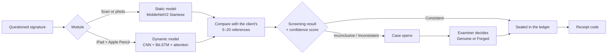
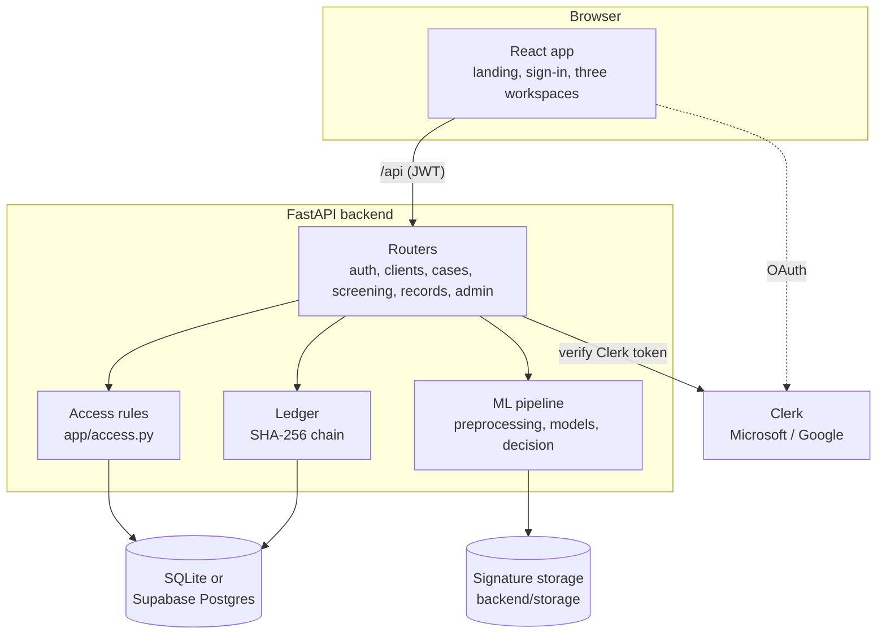

<div align="center">

# ForgeBlock

**Siamese-based bimodal signature screening with a tamper-evident ledger**

Screen a questioned signature against a client's signatures on file, from a scanned page or live on a tablet.
The examiner makes the final call, and every result is sealed in a SHA-256 hash-linked ledger.


A thesis project of **De La Salle University–Dasmariñas** by **CloudNine**

</div>

---

> [!IMPORTANT]
> ForgeBlock is a **screening and decision-support tool**. It does not decide whether a signature is genuine; a qualified examiner does. During the ForgeBlock study it is used only for the approved research activities, not for actual legal, financial or official documents.

## Contents

- [Overview](#overview)
- [Key features](#key-features)
- [How a screening works](#how-a-screening-works)
- [Tech stack](#tech-stack)
- [Architecture](#architecture)
- [Repository structure](#repository-structure)
- [Getting started](#getting-started)
- [Configuration](#configuration)
- [Working as a team](#working-as-a-team)
- [Testing](#testing)
- [Security and privacy](#security-and-privacy)
- [Documentation](#documentation)
- [Team](#team)
- [License](#license)

## Overview

ForgeBlock compares a **questioned signature** with the 5 to 20 genuine signatures a client keeps on file and reports one of three screening results, each with a **confidence score** (0–99%):

| Screening result | Meaning | What happens next |
| --- | --- | --- |
| **Consistent** | Consistent with the client's references | No case is needed |
| **Inconclusive** | Too close to the thresholds to lean either way | A case opens for the examiner |
| **Inconsistent** | Not consistent with the references | A case opens for the examiner |

The examiner decides each case **Genuine** or **Forged**, with notes. Every screening and every decision is sealed in a hash-linked ledger and gets a **receipt code** that anyone can check.

Two independent modules do the screening. They are never fused into one verdict.

| Module | Input | Model | Decision rule |
| --- | --- | --- | --- |
| **Static** | Scanned or photographed signature | MobileNetV2 Siamese embedding | Cosine, Euclidean and Manhattan each vote against a threshold; majority 2 of 3 |
| **Dynamic** | Live signing on iPad + Apple Pencil | 1D-CNN + BiLSTM + attention Siamese encoder (SVC2004) | Mean cosine ≥ τc **and** mean Euclidean ≤ √(2(1 − τc)) |

With 5 or more references on file, ForgeBlock uses **personal thresholds** learned from how much the client's own signatures vary.

## Key features

**Three role-based workspaces**

| Role | Workspace | What they do |
| --- | --- | --- |
| **Examiner** | Blue | Register clients and enroll their references, screen questioned signatures, decide cases, review records |
| **Administrator** | Indigo | Manage accounts and client group folders, set policy and data retention, watch the ledger, audit log and system health |
| **Client** | Teal | See their signatures on file and every screening in their name, in a limited view without model internals |

**Highlights**

- **Invite-only accounts.** No public sign-up. Sign in with email and password, Microsoft or Google (through Clerk); lockout after 5 wrong passwords; automatic sign-out after 15 minutes idle.
- **Group folders.** Each client group has exactly one examiner, and examiners see only their own group.
- **Clear result page.** Result, confidence score, the questioned signature beside its closest reference, and details on demand: scores, handwriting features, difference overlay or stroke replay, ledger proof.
- **Tamper-evident ledger.** SHA-256 hash-linked blocks, an automatic daily check, an on-demand check, and a tamper demo for the defense.
- **Quality checks** before screening, and a "what the model sees" preview.
- **Privacy by design.** No image download or export, no profile photos (initials only), and access rules enforced in the backend on every request.
- **Guided tour** for new users, and a Help Center.

## How a screening works



**The ledger**

1. Each screening and each examiner decision is serialized and hashed with SHA-256 (`record_hash`).
2. A new block stores that hash, the previous block's hash and a timestamp: `block_hash = SHA-256(index | record_hash | previous_hash | timestamp)`.
3. Validation recomputes every hash and every link. Any change to a past record breaks the chain and is reported with the first affected block.

> [!NOTE]
> This is a hash-linked ledger stored in the application database, not a distributed blockchain network.

## Tech stack

| Layer | Technology |
| --- | --- |
| Frontend | React 19, Vite 6, Tailwind CSS 4, React Router 7, Framer Motion (`motion`), Lenis, lucide icons, DM Sans |
| Backend | Python 3.11/3.12, FastAPI, SQLAlchemy 2, Pydantic 2, PyJWT, bcrypt |
| Machine learning | TensorFlow/Keras (static model), PyTorch (dynamic model), OpenCV, NumPy, SciPy |
| Database | SQLite (default) or Supabase Postgres, with Row Level Security |
| Authentication | ForgeBlock sessions (JWT), with Microsoft and Google sign-in through Clerk |
| Data collection | Separate FastAPI tool (`collector/`), deployable with Docker or Render |

## Architecture



## Repository structure

```
ForgeBlock2026/
└── forgeblock/
    ├── backend/            FastAPI app, ML pipeline, ledger, tests, model weights
    │   ├── app/            routers, models, access rules, security, ledger, ml/
    │   ├── weights/        static_model.keras, dynamic_encoder.pt, threshold configs
    │   ├── tests/          API tests (pytest)
    │   ├── seed.py         demo data and evaluation accounts
    │   └── .env.example    configuration template (copy to .env)
    ├── frontend/           React + Vite + Tailwind CSS
    │   └── src/            pages, components, API client
    ├── collector/          researcher-only data collection tool (separate app)
    ├── training/           CEDAR evaluation and SVC2004 dynamic training scripts
    ├── supabase/rls.sql    Row Level Security for every table
    ├── docs/               chapter notes and design references
    └── README.md           full technical reference
```

## Getting started

### Prerequisites

- **Python 3.11 or 3.12** (TensorFlow does not support every newer release yet)
- **Node.js 20+**
- **Git**

### 1. Clone

```bash
git clone https://github.com/aajvr/ForgeBlock2026.git
cd ForgeBlock2026/forgeblock
```

### 2. Backend

```bash
cd backend
python -m venv .venv

# Windows PowerShell
.venv\Scripts\Activate.ps1
# macOS / Linux
source .venv/bin/activate

pip install -r requirements.txt
```

Create your configuration file from the template:

```bash
# Windows
copy .env.example .env
# macOS / Linux
cp .env.example .env
```

Fill in `.env` (see [Configuration](#configuration)), then start the API:

```bash
uvicorn app.main:app --reload --port 8000
```

- API docs: http://localhost:8000/docs
- Health and model status: http://localhost:8000/api/health

### 3. Frontend

In a second terminal:

```bash
cd frontend
npm install
npm run dev
```

Open **http://localhost:5173**. The frontend forwards `/api` to the backend on port 8000.

### 4. First sign-in

Sign in as the seeded administrator: `ADMIN_EMAIL` with `ADMIN_PASSWORD` from `.env` (default `admin@forgeblock.local` / `ChangeMe123!`). You will be asked to choose a new password.

### 5. Demo data (optional)

On an **empty** database, after the admin has changed their password:

```bash
cd backend
python seed.py demo --admin-password <new admin password>
```

This adds examiners, a client account, clients, cases, screenings and decisions. Every demo account uses the password `Demo-pass-2026`.

> [!TIP]
> To use the dynamic module on an iPad, put the laptop and iPad on the same Wi-Fi and open `http://<laptop-ip>:5173` in Safari.

## Configuration

All settings live in `forgeblock/backend/.env`. Start from `.env.example`.

| Variable | Required | Description |
| --- | :---: | --- |
| `DATABASE_URL` | | Empty for local SQLite. For Supabase: the **Session pooler** URI from Project Settings → Database. |
| `JWT_SECRET` | ✓ | Long random string. Generate one with `python -c "import secrets; print(secrets.token_urlsafe(48))"`. |
| `ADMIN_EMAIL`, `ADMIN_PASSWORD`, `ADMIN_NAME` | ✓ | First administrator, created on first start. |
| `RESEARCH_TEAM_EMAILS` | ✓ | Comma-separated emails allowed to hold the admin role. |
| `CLERK_PUBLISHABLE_KEY`, `CLERK_SECRET_KEY` | | Turns on Microsoft and Google sign-in. Leave empty for email and password only. |
| `OAUTH_PROVIDERS` | | `google,microsoft` (default), or one of them. |
| `STUDY_MODE` | | `true` during the study: research-use terms, research labels and evaluation tools. |
| `DEMO_MODE` | | `true` shows the ledger's "Simulate tampering" button to admins. |
| `CORS_ORIGINS` | | Allowed frontend origins, comma-separated. |
| `MIN_ADAPTIVE_SAMPLES` | | References needed before personal thresholds are used (default `5`). |
| `INCONCLUSIVE_BELOW` | | Confidence below which a result is Inconclusive (default `20`). Set from the evaluation. |
| `DEV_PEN_DEVICES` | | Development only: accept a pen without tilt (e.g. Wacom One). Keep `false` for the study. |

> [!WARNING]
> **Never commit `.env`.** It holds the Supabase database password, the Clerk secret key and the JWT secret. It is already in `.gitignore`. Share its values with team members privately, never through the repository or a group chat.

### Supabase

1. Put the Session pooler URI in `DATABASE_URL`.
2. Start the backend once; it creates the tables.
3. Run `supabase/rls.sql` in the Supabase SQL editor so the tables cannot be read through Supabase's public API.

Everyone using the same `DATABASE_URL` shares one database. Leave it empty to work on your own local SQLite database instead.

### Clerk (Microsoft and Google sign-in)

1. Create an application at clerk.com with **Email**, **Google** and **Microsoft** turned on.
2. Copy the publishable key and secret key from **Configure → API keys** into `.env`.
3. Restart the backend; the sign-in buttons appear.

Sign-in stays invite-only: Microsoft and Google work only for emails an administrator has already registered.

## Working as a team

```bash
git pull                                  # get the latest changes before you start
git checkout -b feature/short-description # work on your own branch
git add .
git commit -m "Describe what changed"
git push -u origin feature/short-description
```

Then open a **pull request** on GitHub so a teammate can review it before it is merged into `main`.

**Guidelines**

- Pull before you start, and keep each change focused on one thing.
- Run the tests and `npm run build` and `npm run lint` before pushing.
- Agree on who edits which files to avoid merge conflicts.
- Never commit `.env`, `backend/storage/`, database files, `collector/data/` or evaluation passwords.

## Testing

```bash
# Backend API tests (use a temporary database; no model weights needed)
cd forgeblock/backend && pytest -q

# Frontend build and lint
cd forgeblock/frontend && npm run build && npm run lint

# Data collection tool
cd forgeblock/collector && pytest -q
```

## Security and privacy

ForgeBlock follows the access control and ethical-use rules of Chapter 3, Section 3.8:

- **Accounts are created only by administrators.** There is no sign-up page or endpoint.
- **The admin role** is limited to the research team's emails.
- **Access rules are enforced in the backend** (`app/access.py`) on every request:
  - examiners see only their group's clients, screenings and cases
  - clients see only their own record, in a limited form
- **Signature images cannot be downloaded or exported.** They are served inline with `no-store`, only to users allowed to see them.
- **Passwords** are hashed with bcrypt. Sessions expire after inactivity, and accounts lock after repeated wrong passwords.
- **Supabase tables** are protected with Row Level Security.
- **Signature samples are personal research data** covered by the study's consent forms. They are never committed to the repository.

## Documentation

| Document | Contents |
| --- | --- |
| [`forgeblock/README.md`](forgeblock/README.md) | Full technical reference: models, confidence score, study mode, collector, evaluation accounts, iPad and Wacom setup |
| [`forgeblock/docs/paper-notes.md`](forgeblock/docs/paper-notes.md) | Points to align between the code and Chapters 3 and 4 |
| [`forgeblock/collector/DEPLOY_ONLINE.md`](forgeblock/collector/DEPLOY_ONLINE.md) | Hosting the data collection tool online |
| [`forgeblock/GITHUB_SETUP.md`](forgeblock/GITHUB_SETUP.md) | What goes in the repository and what stays private |
| API docs | http://localhost:8000/docs while the backend runs |

## Team

**CloudNine**, De La Salle University–Dasmariñas

<!-- Add each member's name and role, for example:
| Name | Role |
| --- | --- |
| Name Surname | Project lead, backend |
-->

## License

© 2026 CloudNine. All rights reserved.

This repository is an academic thesis project. The code, trained models and documentation may not be copied, redistributed or used without the authors' permission.
